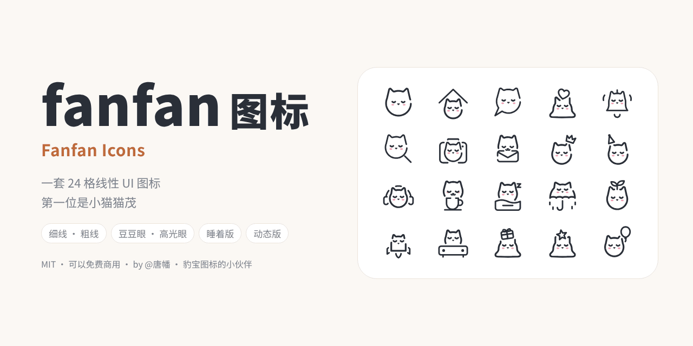

# fanfan 图标 Fanfan Icons



一套 24 格的线性 UI 图标。第一位是小猫**猫茂**：它会叼着信封、托着爱心、把皇冠歪戴在耳朵上。动作图标（箭头、关闭、复制……）保持干净，一眼读懂。

fanfan 是 [豹宝图标](https://github.com/TangfanOVO/baobao-icons) 的小伙伴，画法、尺寸、用法都一样，可以混着用。

- 现在有 544 个图标：猫茂、狗勾和两版兔叽各 111 个（100 个名词加 11 个备选画法），另有 100 个大家共用的动作图标
- 两种粗细：细线、粗线
- 两种眼睛：豆豆眼、高光眼
- 带小动物的图标另有“睡着”的样子，适合放在没选中的 tab 上
- 动态版：会醒来、睡着、眨眼、弹一下、脸红，19 个还有自己的小动作
- 颜色全部跟着文字颜色走（`currentColor`），深色模式不用另画一套
- MIT 授权：个人和商业项目都可以免费用

在线预览：`https://TangfanOVO.github.io/fanfan-icons/`
动态版：`https://TangfanOVO.github.io/fanfan-icons/motion/`

## 住着谁

| 小动物 | 文件名前缀 | 图标数 |
| --- | --- | --- |
| 猫茂（小猫） | `cat-` | 111 个 |
| 狗勾（小狗） | `dog-` | 111 个 |
| 兔叽 · 折耳（一只耳朵折下来的小兔） | `lop-` | 111 个 |
| 兔叽 · 竖耳（两只耳朵都竖着的小兔） | `bunny-` | 111 个 |

所有小动物都放在同一套文件夹里，只靠文件名前缀区分。以后有新动物搬进来，链接的写法不会变。

## 文件在哪

```
svg/
  thin/               细线 · 豆豆眼（默认用这一套）
  thick/              粗线 · 豆豆眼
  thin-highlight/     细线 · 高光眼
  thick-highlight/    粗线 · 高光眼
  thin-sleep/         细线 · 睡着（只有带小动物的图标）
  thick-sleep/        粗线 · 睡着
sprite/
  fanfan-thin.svg ……  每种样式一个雪碧图，每个图标是一个 <symbol>
motion/               动态版（用法见 motion/README.md）
preview/              宣传图和动图
icons.json            所有图标的名字、中文名、属于哪只小动物
index.html            预览页
```

## 命名

- 带小动物的名词：`动物-名词`，例如 `cat-home`、`dog-home`、`lop-home`、`bunny-home`
- 动作：只有名词，例如 `close`、`arrow-left`、`copy`（所有小动物共用，也和豹宝的动作图标一样）
- 备选画法：在后面加一段，例如 `cat-heart-chin`（下巴托着心）、`cat-icecream-top`（顶着冰淇淋）

完整列表见 `icons.json`，或者打开预览页搜索。

## 怎么用

### 1. 直接把 SVG 贴进网页（最推荐）

打开 `svg/thin/cat-home.svg`，把内容复制进 HTML。改颜色用 CSS `color`，改大小用 `width` / `height`：

```html
<span style="color:#41678a">
  <!-- 粘贴 cat-home.svg 的内容 -->
</span>
```

### 2. 雪碧图

```html
<svg width="24" height="24" aria-hidden="true">
  <use href="sprite/fanfan-thin.svg#cat-home"/>
</svg>
```

雪碧图要和网页在同一个域名下才能这样引用。

### 3. 通过 CDN 直接引用（不用下载）

```
https://cdn.jsdelivr.net/gh/TangfanOVO/fanfan-icons@main/svg/thin/cat-home.svg
```

用 `` 引用时，`currentColor` 不会继承文字颜色，图标固定是黑色。需要变色时用第 1 种或第 2 种方法。

### 4. React / Vue

把 SVG 文件交给 [SVGR](https://react-svgr.com/)（React）或 vite-svg-loader（Vue）转成组件，属性会原样保留。

### 5. 安卓

Android Studio：右键 `res` → New → Vector Asset → Local file，选择 SVG 文件导入。

### 6. iOS

把 SVG 拖进 Xcode 的 Assets，勾选 Preserve Vector Data。如果设成 Render As Template Image，腮红也会被染成同一种颜色。

### 7. Figma / 设计稿

直接把 SVG 文件拖进画布。

## 颜色

- 线条、眼睛和小鼻子：`currentColor`，跟着文字颜色走。
- 粉腮红：固定是 `#F08AA8`，带 `class="tt-blush"`。只想要单色的话，在页面上加一行：

```css
.tt-blush { fill: currentColor; fill-opacity: .32; }
```

## 尺寸

- 默认 24px，tab 栏、导航栏、工具栏都用这个。
- 行内配正文用 20px；密集列表可以用 16px。
- 48px 以上适合空状态和贴纸。

## 无障碍

纯装饰的图标加 `aria-hidden="true"`。单独当按钮的图标，在按钮上写 `aria-label`（例如“主页”），不要让读屏念出 `cat-home`。

## 授权

fanfan 图标 © 2026 唐幡，按 [MIT](LICENSE) 授权。

- 个人项目、商业项目都可以免费用，也可以修改、二次发布。
- 唯一的要求：复制或二次发布这套图标时，保留 `LICENSE` 里的版权声明。
- 在产品里用不用署名都可以；愿意的话写一句“图标：fanfan 图标 by @唐幡”，幡幡会很开心。

注意：豹宝图标是另一个仓库，授权仍然是 CC BY-NC 4.0（不能商用），和这里不一样。

---

## English

Fanfan Icons is a growing family of line icons on a 24px grid, a sibling of [Baobao Icons](https://github.com/TangfanOVO/baobao-icons). The first resident is Maomao, a small cat (`cat-*`); new animals join under their own prefixes. Action icons (`close`, `copy`, …) are shared by everyone. Two stroke weights, two eye styles, a sleeping variant for inactive tabs, and a motion edition in `motion/`. All strokes use `currentColor`. Licensed under MIT: free for personal and commercial use; keep the copyright notice when you redistribute the icons. (Baobao Icons stays under CC BY-NC 4.0.)
