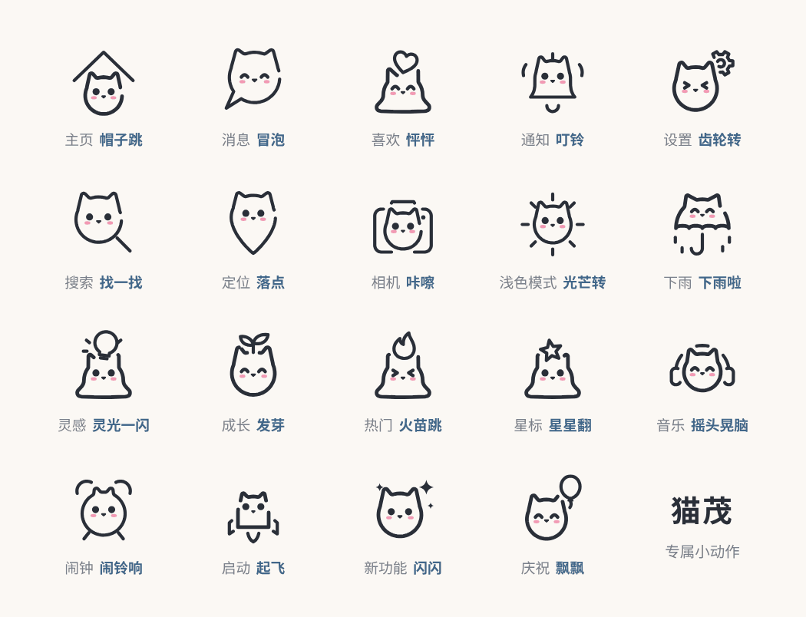

# fanfan 图标 · 动态版



猫茂、狗勾和两版兔叽各 111 个图标都会动：醒来、睡着、待机眨眼、弹一下、脸红。其中 19 个还有自己的小动作，比如铃铛叮铃、齿轮转、下雨。

在线预览：`https://TangfanOVO.github.io/fanfan-icons/motion/`

## 文件在哪

```
motion/
  svg/
    thin/               细线 · 豆豆眼
    thick/              粗线 · 豆豆眼
    thin-highlight/     细线 · 高光眼
    thick-highlight/    粗线 · 高光眼
  fanfan-motion.css     所有动作
  fanfan-motion.js      一个很小的播放助手（不用也行）
  motion.json           图标列表，哪些有专属动作
  index.html            预览页
```

动态版的文件名和静态版一样，例如 `motion/svg/thin/cat-home.svg`。

## 怎么用

动态版只能**直接贴进网页**用。放进 `` 里的 SVG 收不到点击，也没法切换状态。

### 1. 引入样式和助手

```html
<link rel="stylesheet" href="https://cdn.jsdelivr.net/gh/TangfanOVO/fanfan-icons@main/motion/fanfan-motion.css">
<script src="https://cdn.jsdelivr.net/gh/TangfanOVO/fanfan-icons@main/motion/fanfan-motion.js"></script>
```

### 2. 把 SVG 的内容贴进 HTML

打开 `motion/svg/thin/cat-home.svg`，把整段 `<svg …>…</svg>` 复制进页面。改颜色用 CSS `color`，改大小用 `width` / `height`。

### 3. 让它动

```js
const icon = document.querySelector("#home-tab svg");
FanfanMotion.play(icon, "wake");    // 醒来
FanfanMotion.play(icon, "sleep");   // 睡着
FanfanMotion.play(icon, "bounce");  // 弹一下
FanfanMotion.play(icon, "blush");   // 脸红
FanfanMotion.play(icon, "trick");   // 专属动作（有的图标才有）
FanfanMotion.asleep(icon, true);    // 直接睡着，不播动画
FanfanMotion.idle(icon, true);      // 待机：慢慢呼吸，偶尔眨眼
```

不想用助手的话，直接改 `<svg>` 上的 class 也一样：

| class | 作用 |
| --- | --- |
| `is-asleep` | 睡着的样子（静止状态） |
| `idle` | 待机：呼吸和眨眼，一直循环 |
| `do-wake` / `do-sleep` | 醒来 / 睡着 |
| `do-bounce` / `do-blush` / `do-trick` | 弹一下 / 脸红 / 专属动作 |

同一个 `do-*` class 想再播一次，要先去掉，再加回来。

### tab 栏的例子

没选中的 tab 睡着，被选中的醒过来，再点一下已经选中的会弹一下：

```js
let current = document.querySelector(".tab.active");
document.querySelectorAll(".tab").forEach(tab => {
  if (tab !== current) FanfanMotion.asleep(tab, true);
  tab.addEventListener("click", () => {
    if (tab === current) return FanfanMotion.play(tab, "bounce");
    FanfanMotion.play(current, "sleep");
    FanfanMotion.play(tab, "wake");
    current = tab;
  });
});
```

### React / Vue

用 SVGR（React）或 vite-svg-loader（Vue）把 SVG 转成组件时，class 会原样保留。拿到组件的 ref 后调用 `FanfanMotion.play(ref.current, "wake")`。

## 几点注意

- **跳起来会超出 24 格一点。** 弹一下和醒来时，最高的图标会往上多出约 3 格。文件里已经写了 `overflow="visible"`，别让外层容器把它裁掉就好。
- **没加样式时是静止的。** 没有引入 `fanfan-motion.css` 时，动态版看起来和静态版的醒着状态一样。
- **减少动态。** 系统打开“减少动态”后，助手会直接跳到动作结束的样子，待机动画也会停下。
- **App。** 动态版现在是网页用的 CSS 动画。App 里常用的 Lottie 版以后再做。

## 专属动作

| 图标 | 动作 |
| --- | --- |
| 搜索 `cat-search` | 找一找 |
| 消息 `cat-chat` | 冒泡 |
| 通知 `cat-bell` | 叮铃 |
| 相机 `cat-camera` | 咔嚓 |
| 定位 `cat-location` | 落点 |
| 浅色模式 `cat-sun` | 光芒转 |
| 喜欢 `cat-heart` | 怦怦 |
| 星标 `cat-star` | 星星翻 |
| 灵感 `cat-bulb` | 灵光一闪 |
| 热门 `cat-fire` | 火苗跳 |
| 主页 `cat-home` | 帽子跳 |
| 音乐 `cat-music` | 摇头晃脑 |
| 设置 `cat-settings` | 齿轮转 |
| 下雨 `cat-umbrella` | 下雨啦 |
| 成长 `cat-sprout` | 发芽 |
| 闹钟 `cat-alarm` | 闹铃响 |
| 启动 `cat-rocket` | 起飞 |
| 新功能 `cat-sparkles` | 闪闪 |
| 庆祝 `cat-balloon` | 飘飘 |
| 搜索 `dog-search` | 找一找 |
| 消息 `dog-chat` | 冒泡 |
| 通知 `dog-bell` | 叮铃 |
| 相机 `dog-camera` | 咔嚓 |
| 定位 `dog-location` | 落点 |
| 浅色模式 `dog-sun` | 光芒转 |
| 喜欢 `dog-heart` | 怦怦 |
| 星标 `dog-star` | 星星翻 |
| 灵感 `dog-bulb` | 灵光一闪 |
| 热门 `dog-fire` | 火苗跳 |
| 主页 `dog-home` | 帽子跳 |
| 音乐 `dog-music` | 摇头晃脑 |
| 设置 `dog-settings` | 齿轮转 |
| 下雨 `dog-umbrella` | 下雨啦 |
| 成长 `dog-sprout` | 发芽 |
| 闹钟 `dog-alarm` | 闹铃响 |
| 启动 `dog-rocket` | 起飞 |
| 新功能 `dog-sparkles` | 闪闪 |
| 庆祝 `dog-balloon` | 飘飘 |
| 搜索 `lop-search` | 找一找 |
| 消息 `lop-chat` | 冒泡 |
| 通知 `lop-bell` | 叮铃 |
| 相机 `lop-camera` | 咔嚓 |
| 定位 `lop-location` | 落点 |
| 浅色模式 `lop-sun` | 光芒转 |
| 喜欢 `lop-heart` | 怦怦 |
| 星标 `lop-star` | 星星翻 |
| 灵感 `lop-bulb` | 灵光一闪 |
| 热门 `lop-fire` | 火苗跳 |
| 主页 `lop-home` | 帽子跳 |
| 音乐 `lop-music` | 摇头晃脑 |
| 设置 `lop-settings` | 齿轮转 |
| 下雨 `lop-umbrella` | 下雨啦 |
| 成长 `lop-sprout` | 发芽 |
| 闹钟 `lop-alarm` | 闹铃响 |
| 启动 `lop-rocket` | 起飞 |
| 新功能 `lop-sparkles` | 闪闪 |
| 庆祝 `lop-balloon` | 飘飘 |
| 搜索 `bunny-search` | 找一找 |
| 消息 `bunny-chat` | 冒泡 |
| 通知 `bunny-bell` | 叮铃 |
| 相机 `bunny-camera` | 咔嚓 |
| 定位 `bunny-location` | 落点 |
| 浅色模式 `bunny-sun` | 光芒转 |
| 喜欢 `bunny-heart` | 怦怦 |
| 星标 `bunny-star` | 星星翻 |
| 灵感 `bunny-bulb` | 灵光一闪 |
| 热门 `bunny-fire` | 火苗跳 |
| 主页 `bunny-home` | 帽子跳 |
| 音乐 `bunny-music` | 摇头晃脑 |
| 设置 `bunny-settings` | 齿轮转 |
| 下雨 `bunny-umbrella` | 下雨啦 |
| 成长 `bunny-sprout` | 发芽 |
| 闹钟 `bunny-alarm` | 闹铃响 |
| 启动 `bunny-rocket` | 起飞 |
| 新功能 `bunny-sparkles` | 闪闪 |
| 庆祝 `bunny-balloon` | 飘飘 |

## 授权

fanfan 图标 © 2026 唐幡，按 [MIT](../LICENSE) 授权，和静态版相同：个人和商业项目都可以免费用，二次发布时保留版权声明就好。

---

## English

The motion edition: all 111 Maomao (cat), 111 dog and 2 × 111 bunny icons can wake up, fall asleep, idle (breathing and blinking), bounce and blush, and 19 of them have a trick of their own. Paste the SVG inline (it won't animate inside ``), include `fanfan-motion.css`, then call `FanfanMotion.play(svg, "wake" | "sleep" | "bounce" | "blush" | "trick")` from `fanfan-motion.js`, or toggle the `is-asleep`, `idle` and `do-*` classes on the `<svg>` yourself. MIT, same as the static set.

fanfan 和豹宝用的是同一套动作和同一个助手：页面上同时用两套时，只引入一份 CSS 和 JS 就够了，`FanfanMotion` 和 `BaobaoMotion` 是同一个东西。以后有新的小动物，也用这同一套。
